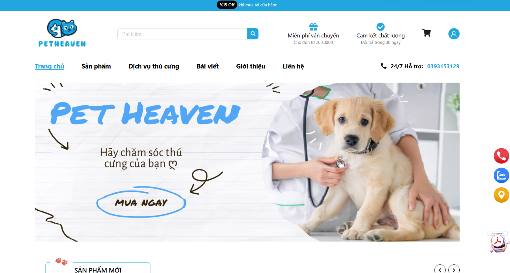
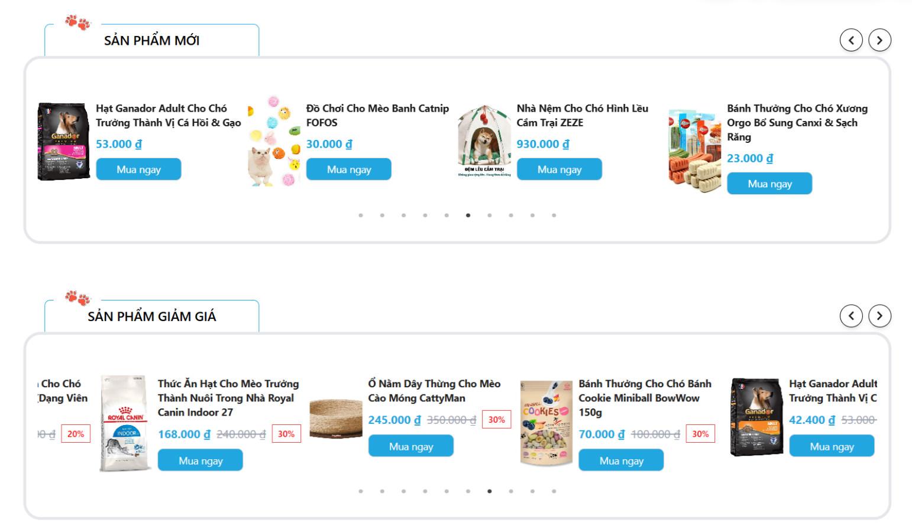
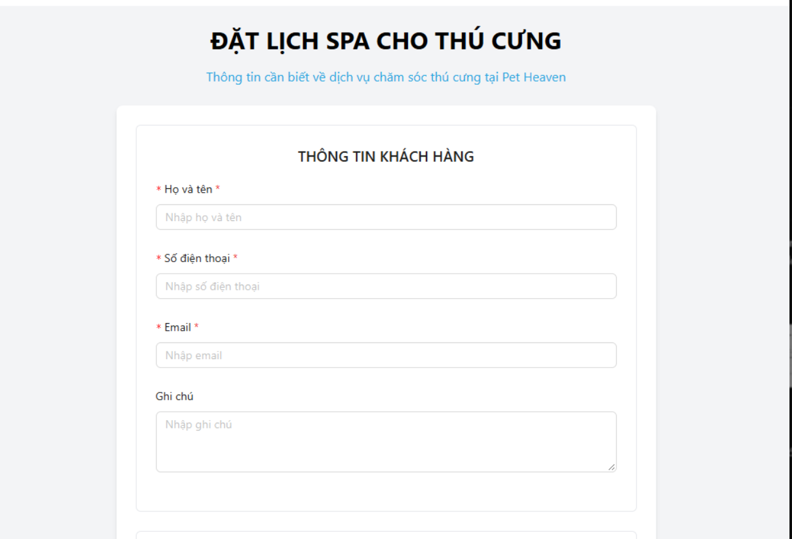
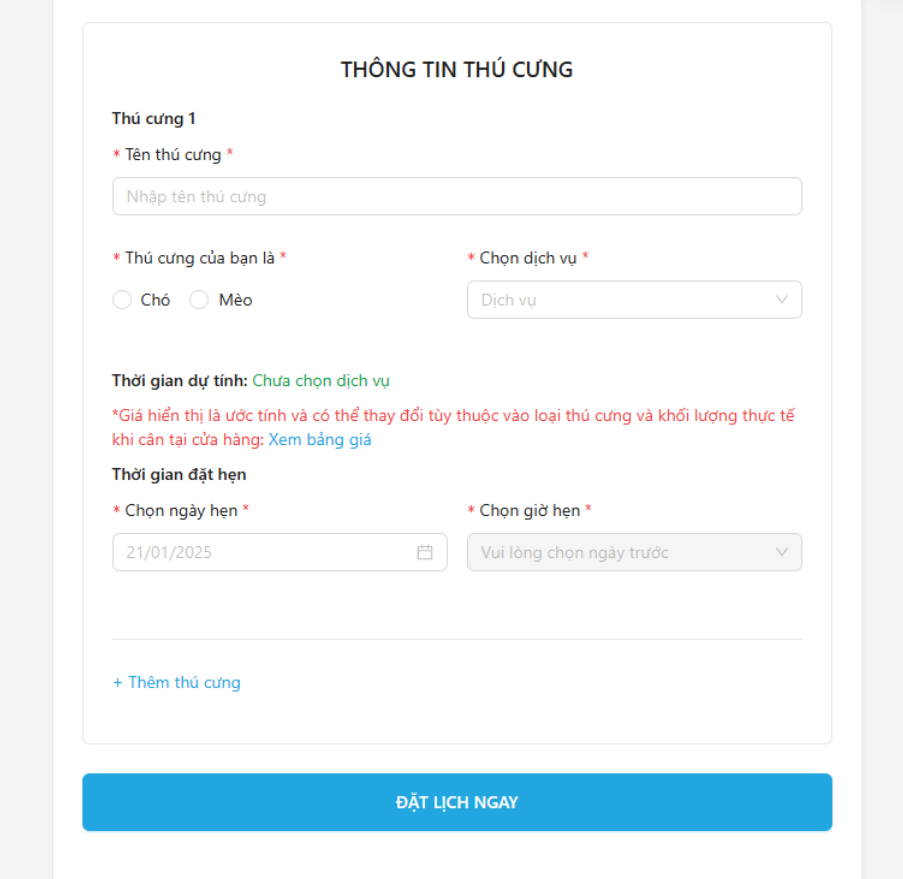
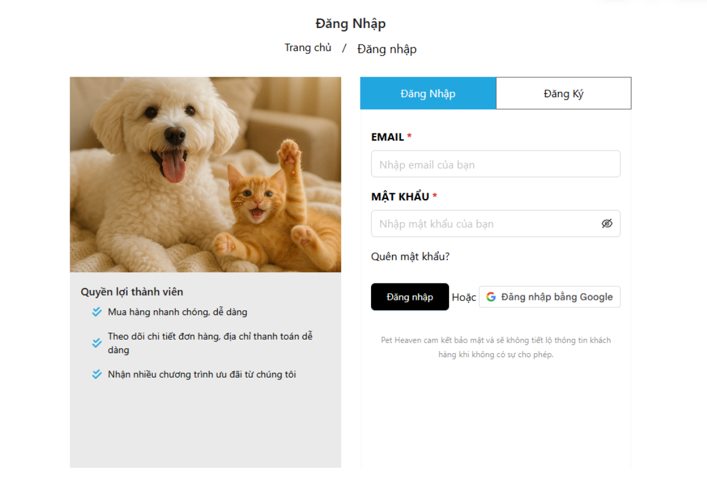
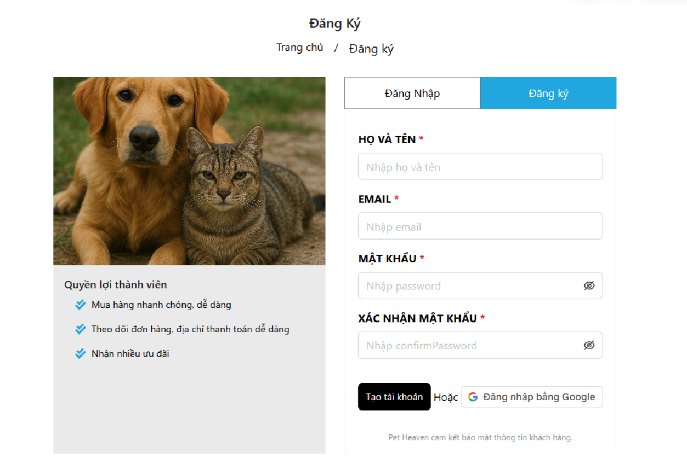
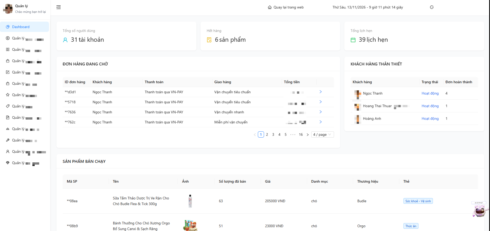

# 🐾 Pet Heaven — Graduation Project

**Pet Care E-commerce & Service Booking Web Application**

Pet Heaven is a college graduation project developed by a team of five students at FPT Polytechnic in 2025.

The project combines an online pet product store with pet care service booking and an administration interface.

My primary contributions focused on **UI/UX design using Figma** and **frontend development**, working collaboratively with teammates on different features.

## 📌 Project Overview

| Information | Details |
|---|---|
| Project | Pet Heaven |
| Type | College Graduation Project |
| Year | 2025 |
| Team Size | 5 members |
| My Role | UI/UX Designer & Frontend Contributor |
| Institution | FPT Polytechnic |
| Source Repository | Private team repository |

## ✨ Key Features

The project includes the following modules and interfaces:

- **User Authentication:** Login, registration, and related account features.
- **Product Browsing:** Pet product listings, product information, and promotional sections.
- **Pet Care Services:** Service information and appointment booking interfaces.
- **Appointment Booking:** Customer information, pet details, service selection, and preferred appointment date/time.
- **Admin Dashboard:** Administrative interfaces for managing different areas of the system.

## 👨‍💻 My Contributions

### UI/UX Design

- Took primary responsibility for designing user interfaces using Figma.
- Worked on layouts and user-facing screens as part of the team's design process.
- Collaborated with teammates to translate designs into frontend interfaces.

### Frontend Development

Contributed to frontend implementation across assigned tasks, including:

- Admin interface layout and related updates.
- Authentication-related functionality and UI changes.
- Frontend routing and navigation for pet service booking.
- Additional changes related to account management and administrative features.

**Verified implementation example — Service Booking**

In commit `5856f37` (March 9, 2025), I contributed changes that:

- Added a service booking component to the application's routing configuration.
- Connected the service information page to the booking route.
- Added navigation behavior to the booking button using React Router.

Development was collaborative, and feature ownership was shared across the team.

## 🛠️ Technologies

### Frontend
- React
- TypeScript / JavaScript
- React Router
- Ant Design
- Tailwind CSS

### Design & Collaboration
- Figma
- Git & GitHub

*The listed technologies are based on project files reviewed so far. The complete technology stack has not yet been documented.*

## 📸 Project Screenshots

### Homepage

The customer-facing homepage introduces pet products, promotions, and service navigation.

### Product Listings

Product sections display available items, prices, and promotional information.

### Pet Spa Appointment Booking

The booking interface collects customer information and pet details, including service and appointment preferences.

### Authentication

Login and registration interfaces developed for the customer-facing application.

### Admin Dashboard

The administration dashboard provides an overview of system data and access to management modules.

## 🎨 UI/UX Design

The project's UI design is available on Figma:

**[View Pet Heaven Design on Figma](https://www.figma.com/design/kZmzo5wghSSrpyoi7eHTU3/DATN_Frontend2025?node-id=0-1)**

## 🤝 Team Collaboration

Pet Heaven was developed by a five-member team.

Responsibilities were distributed across frontend development, backend development, and interface design. One teammate primarily handled backend development, while I took a leading role in Figma design and participated in frontend implementation alongside other members.

This repository documents the project and my individual contributions. It does not represent the entire team's work as my own.

## 📚 What I Learned

Working on Pet Heaven helped me gain practical experience in:

- Collaborating on a team-based software development project.
- Translating UI designs into working frontend components.
- Understanding user workflows across authentication, e-commerce, and booking features.
- Using Git branches and commits in a shared development environment.
- Working with different application modules and coordinating frontend changes.

These experiences also provide useful context for my current focus on **Software Quality Assurance and Testing**.

---

*Pet Heaven — FPT Polytechnic Graduation Project, 2025.*
